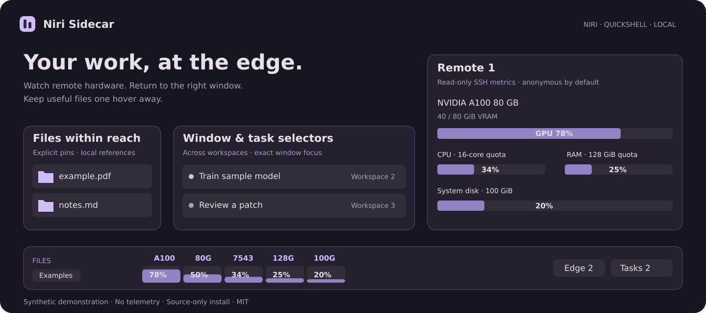

# Niri Sidecar

**在桌面边缘查看远端资源、切换任务窗口、取用文件。**

[English](README.md) · [隐私说明](docs/privacy.md) · [安装与可选模块](docs/installation.md) · [参与贡献](CONTRIBUTING.md)



这是一组给 Niri / Quickshell 使用的桌面工具。它从实际的远程 GPU 工作场景中拆分而来，三个主要模块可以分别启用：

- **SSH 远端资源条**：识别当前用户的交互式 SSH 会话，显示 GPU 型号、计算利用率、显存、CPU、内存、磁盘容量。每项上方是型号或容量，下方是百分比块；悬停显示详细数据。
- **窗口／任务选择器**：从右下角查看 Edge、Ghostty 等应用的窗口，跨工作区单击返回。应用 ID 可配置；标题中带 Braille 旋转符号的终端标为运行中。可选的实时预览只在内存里处理画面。
- **文件入口**：把文件引用固定到左侧入口，之后复制回剪贴板；可选的 Nautilus 停靠模块，让浮动文件夹移开鼠标后自动收起、从标签恢复。

资源采样会优先使用可见的容器 CPU 配额与内存限制，避免把宿主机整机资源当成租用实例资源；拿不到相关限制时会标注为宿主机数据。磁盘容量来自 `df`，不是云平台余额或账单。

## 安装

需要 Linux、Niri、Quickshell、Python 3.10+、OpenSSH 和 wl-clipboard。基础监控不需要在远端安装常驻程序或 Python；NVIDIA 指标需要远端有 `nvidia-smi`。

```sh
git clone https://github.com/yuntaoyulong/niri-sidecar.git
cd niri-sidecar
/usr/bin/python3 install.py
~/.local/bin/niri-sidecar doctor
~/.local/bin/niri-sidecar run
```

检查前台运行正常后，可启用用户服务自启动：

```sh
/usr/bin/python3 install.py --enable
```

配置位于 `~/.config/niri-sidecar/config.json`，已有配置不会被安装器覆盖。完整示例见 [examples/config.json](examples/config.json)。模块独立开关，默认不开启窗口缩略图、普通剪贴板内容固定和 Nautilus 注入钩子。

远端采样使用 OpenSSH 的独立复用连接，默认每 3 秒更新；保留本机 SSH 代理／跳板与身份配置，关闭额外端口转发和代理转发。需要密钥、agent 或可复用连接，工具不会索要或保存密码，未知主机不会自动加入信任。

## 隐私

项目没有遥测或上传接口。发布包中不包含原作者的服务器地址、用户名、本机绝对路径、SSH 配置、密钥、任务记录、截图或文件固定数据库。示例图是用虚构数据绘制的界面示意。

运行时，工具需要读取当前用户的 SSH 命令参数、窗口标题以及主动固定的文件信息，才能完成对应功能。这些信息留在本机。默认把远端地址显示为 `Remote 1`、`Remote 2`；这项匿名化不覆盖本地窗口标题和文件名，分享屏幕或诊断输出时仍需检查。

`niri-sidecar copy 文件...` 可以把本地文件放入剪贴板；固定的是引用，原文件仍需保留。文件固定仅在点击时保存，不会自动记录文本或图片剪贴板历史。实时预览默认关闭，开启后画面不写入截图目录。

更多数据流、文件权限和卸载说明见 [隐私说明](docs/privacy.md)。

## 使用与贡献

```sh
niri-sidecar copy ./report.pdf
./bin/niri-sidecar demo          # 仅使用内置虚构数据的界面预览
./bin/niri-sidecar demo --json   # 查看虚构数据结构
/usr/bin/python3 -m unittest discover -s tests -v
```

已经测试的开发环境是 Ubuntu 26.10、Niri 26.04、Quickshell 0.3.2、GTK 4.24。Nautilus 钩子仍属于实验功能；终端的“运行中”标记依赖窗口标题，不读取 Codex 对话或内部数据库。

欢迎提交 AMD GPU 支持、其他文件管理器适配、主题／位置改进和无障碍问题。指标计算的更改请附可复现样本或独立依据。详见 [贡献说明](CONTRIBUTING.md)，也可以先在 [Discussions](https://github.com/yuntaoyulong/niri-sidecar/discussions) 讨论。

采用 [MIT 许可证](LICENSE)。
